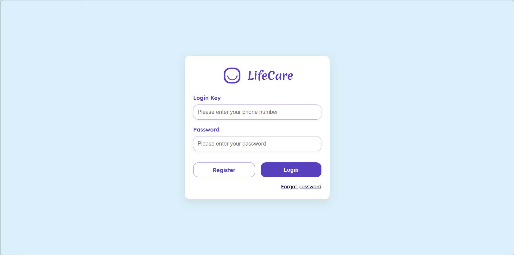
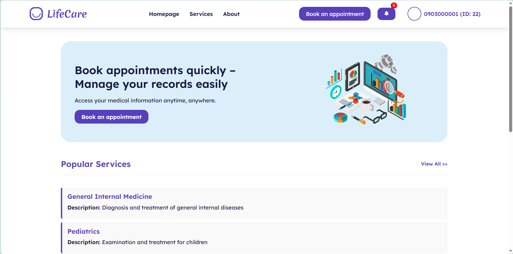
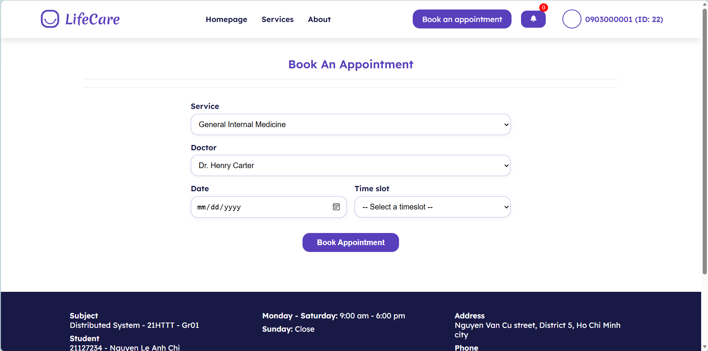
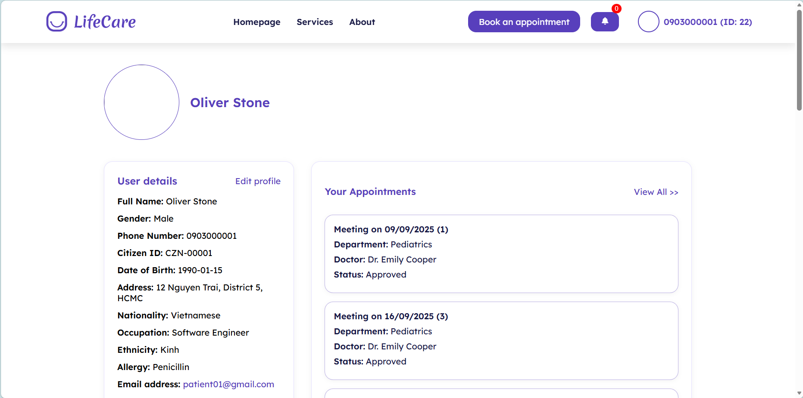
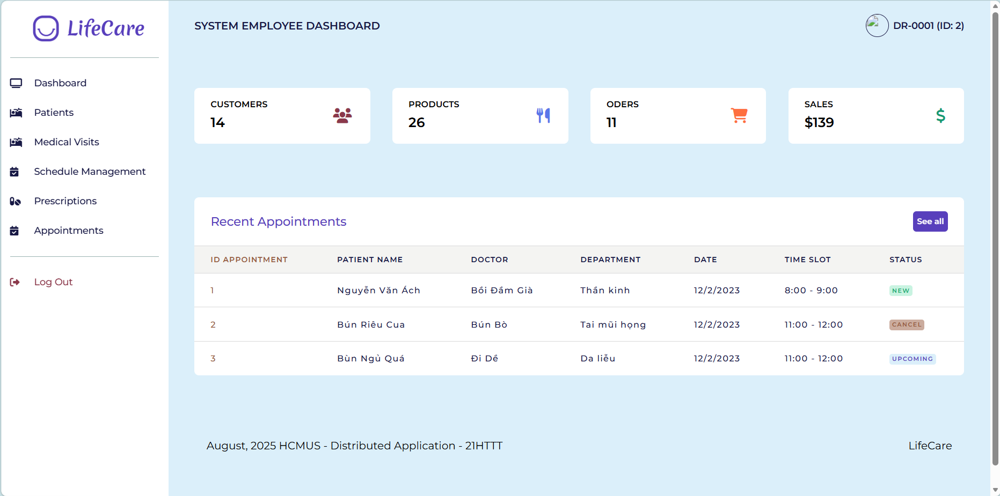
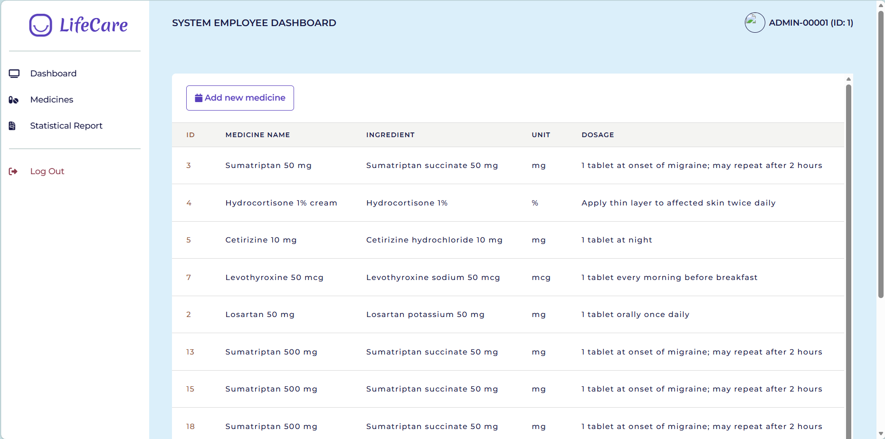

# Distributed Application - Healthcare System

A distributed hospital management system built with a microservice architecture. Patients can book appointments and manage their profiles, doctors can handle examinations and prescriptions, staff can support daily operations, and administrators can manage the medicine catalog.

> Team project (4 members).

## Features by Role

| Role | Features |
|------|----------|
| **All users** | Register, log in, log out |
| **Patient** | Book an appointment, create and update patient profile, view appointment list, view examination history |
| **Doctor** | Look up medical records, view appointments, add examination schedule, update medical records, prescribe medication, view prescription list and details, view and add examination tickets, view patient list |
| **Staff** | Book appointments, create patient profiles, view patient list, view and add examination tickets, view prescription list, update prescription status |
| **Admin** | View, add, update and delete medicines, generate statistics reports |

## Architecture

The frontend talks to the backend services through an API Gateway. Each service owns its own data.

| Component | Port | Technology | Data store |
|-----------|------|-----------|------------|
| Frontend | 8082 | Laravel (PHP 8.2) | - |
| API Gateway | 9000 | Nginx | - |
| Patient Service | 8000 | Laravel | MySQL |
| Appointment Service | 8001 | Laravel | PostgreSQL (Supabase) |
| Authentication Service | 8002 | Laravel, JWT | PostgreSQL (Supabase) |
| Employee Service | 8003 | Laravel | PostgreSQL (Supabase) |
| Medical Catalog Service | 8004 | Laravel | PostgreSQL (Supabase) |
| Notification Service | 8005 | Laravel | MongoDB Atlas |
| Log Service | 3000 | Node.js | - |
| Message broker | - | RabbitMQ (CloudAMQP) | - |

RabbitMQ is used for appointment reminder notifications between the Appointment and Notification services.

## Getting Started

### Prerequisites

- Docker Desktop (with Docker Compose)
- XAMPP (only if you run MySQL or phpMyAdmin locally)
- Git

### 1. Clone the repository

```bash
git clone https://github.com/CatLe2003/DistributedApplication-HealthcareSystem.git
cd DistributedApplication-HealthcareSystem
```

### 2. Configure environment files

Each service has its own `.env` file inside its folder (for example `AuthenticationService/.env`). Copy the example file and fill in your own values:

```bash
cp AuthenticationService/.env.example AuthenticationService/.env
```

Repeat for every service. The values you need to provide:

| Variable | Description |
|----------|-------------|
| `DB_URL` / `DB_*` | Database connection (Supabase PostgreSQL or MySQL) |
| `JWT_SECRET` | Secret used to sign login tokens (use a long random string) |
| `RABBITMQ_HOST`, `RABBITMQ_PORT`, `RABBITMQ_USER`, `RABBITMQ_PASSWORD`, `RABBITMQ_VHOST` | RabbitMQ connection, required by the Appointment and Notification services |
| `DB_URI` | MongoDB connection string (Notification Service) |

> Never commit real credentials. Make sure `.env` is listed in `.gitignore`.

### 3. Prepare the databases

Import the SQL files into the matching database before first use (for example with the Supabase SQL Editor): `AuthService_DB.sql`, `EmployeeService_DB.sql`, `MedicalCatalog_DB_supabase.sql`, and the Patient and Appointment schemas.

### 4. Start the system

```bash
docker compose up -d --build
```

The first start can take a few minutes because each service runs `composer install`.

### 5. Open the application

Go to **http://localhost:8082/login**

## Demo Accounts

| Role | Login key | Password |
|------|-----------|----------|
| Admin | `ADMIN-00001` | `123456` |
| Doctor | `DR-0001` | `123456` |
| Staff | `EMP-00011` | `123456` |
| Patient | `0903000001` | `123456` |

## Useful Commands

```bash
docker compose ps                         # check running containers
docker compose logs -f <service>          # follow logs of a service
docker compose exec <service> php artisan route:list
docker compose down                       # stop everything
```

## Troubleshooting

- **Blank page or `ERR_EMPTY_RESPONSE`**: services are still installing dependencies. Wait a minute and check `docker compose logs <service>`.
- **Database connection errors**: verify `DB_URL` in the service's `.env`, then run `php artisan config:clear` inside the container.
- **Appointment reminder errors**: check the `RABBITMQ_*` values in the Appointment and Notification services.

## Screenshots

### Login


### Home page (Patient)


### Book an appointment


### Patient profile


### Home page (Doctor)


### Medicine management (Admin)


## Team

| # | Member | Responsibilities | Contribution |
|---|--------|------------------|--------------|
| 1 | Nguyen Le Anh Chi | System design; backend for Patient Service; Dockerization and API Gateway configuration; displaying data on the UI | 25% |
| 2 | Nguyen Xuan Quynh Chi | Database design; finalizing diagrams and meeting minutes; data creation; backend for Notification Service | 25% |
| 3 | Le Ngo Song Cat | System design; backend for Employee, Appointment, Authentication and Medical Catalog Services; message queue handling | 25% |
| 4 | Bui Ngoc Kieu Nhi | Database design; UI design; full UI implementation; displaying data on the UI | 25% |